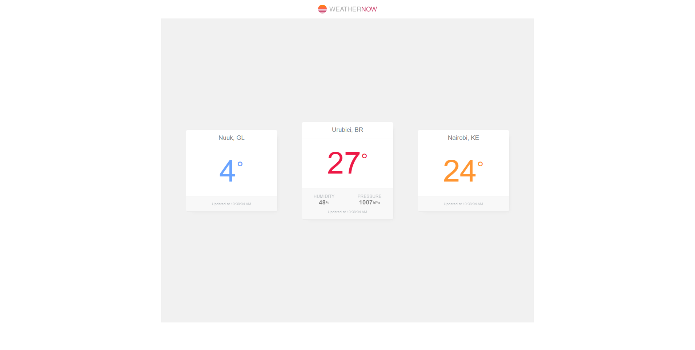
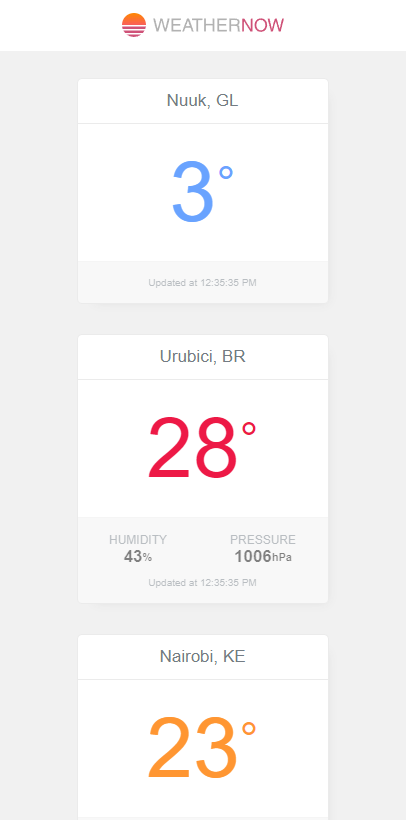

# Weathernow
> Aplicação para exibir a temperatura de 3 cidades diferentes.

A aplicação exibe a temperatura atual de Nuuk/GL, Urubici/BR e Nairobi/KE, assim como outros detalhes sobre o clima das cidades, atualizando sempre a cada 10 minutos.



## API

https://openweathermap.org/

## Configuração de desenvolvimento

```sh
git clone https://github.com/Maikoncg/weathernow.git
```

```sh
npm install
```

Crie um arquivo `.env` na raiz (use o `.env.example` como modelo) com a sua chave da API do [OpenWeatherMap](https://openweathermap.org/api):

```sh
VUE_APP_OPENWEATHER_API_KEY=sua_chave_aqui
```

Compilação:

```sh
npm run serve
```

Testes unitários:

```sh
npm run test:unit
```
## Utilização

Com esta aplicação, o usuário conseguirá visualizar a temperatura destas cidades em qualquer lugar, já que a mesma é totalmente responsiva e de fácil utilização.
Ao entrar na aplicação o usuário já conseguirá visualizar as informações do clima das cidades sem precisar fazer qualquer tipo de ação.

Visão mobile:



## Autor

Maikon Camilo Gosch –  Maikon Camilo Gosch

https://github.com/Maikoncg

